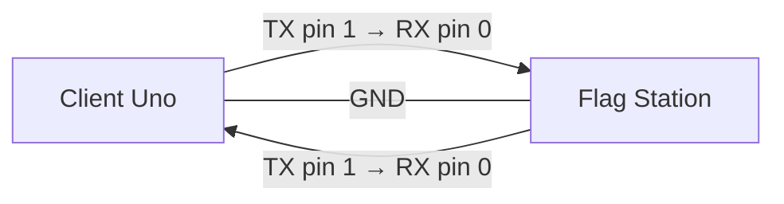
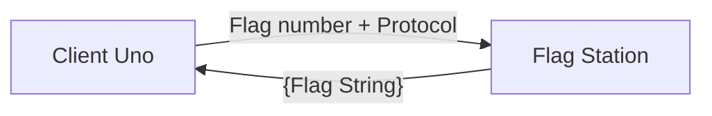
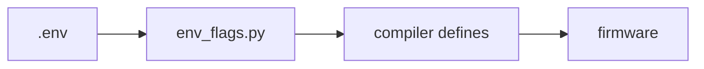
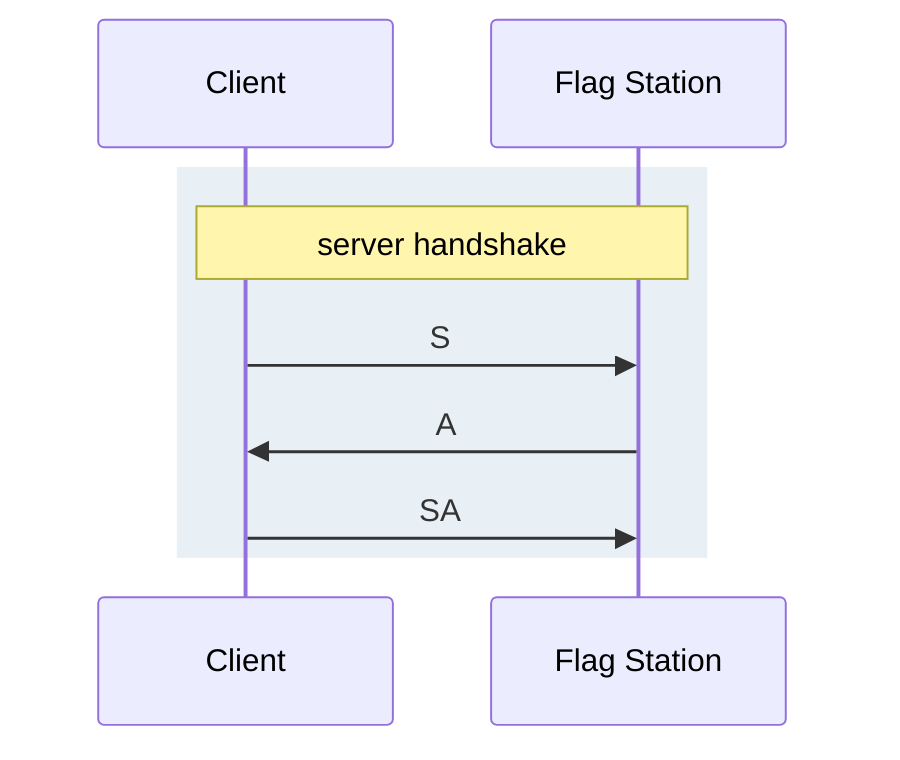
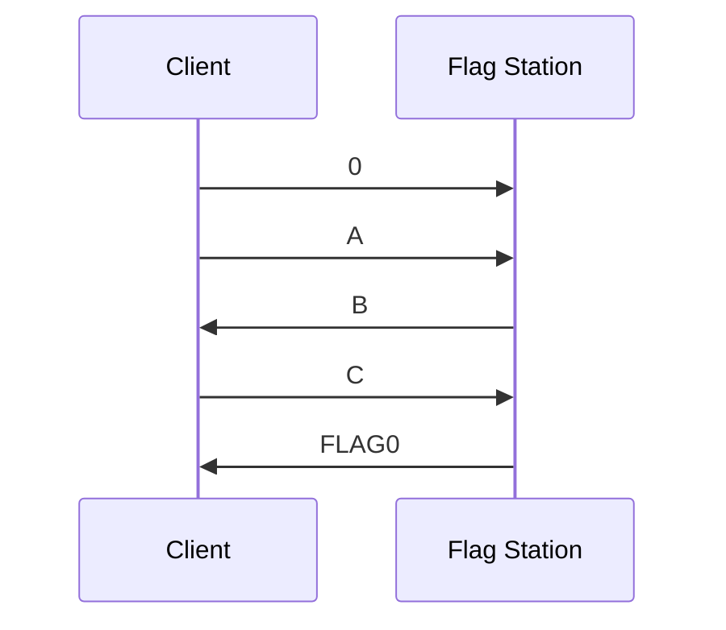
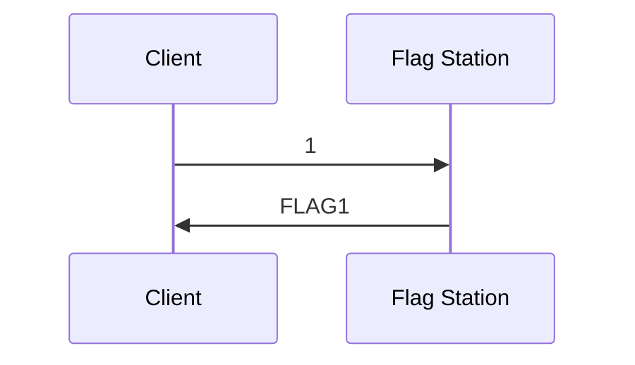
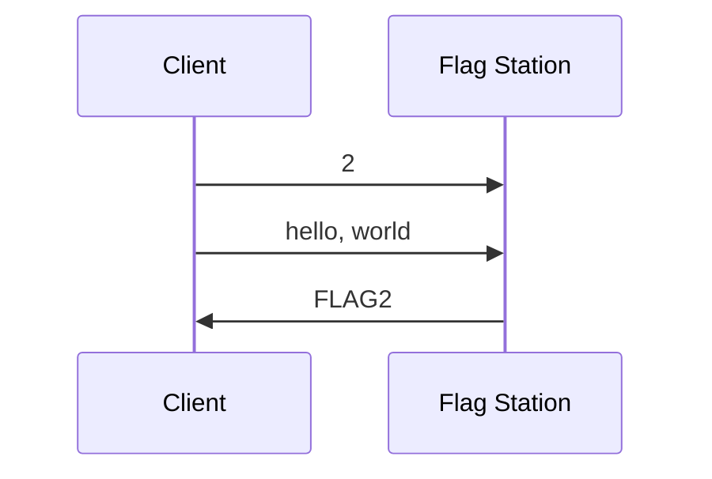
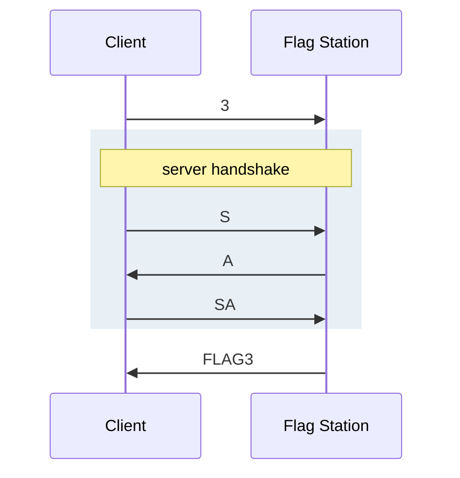
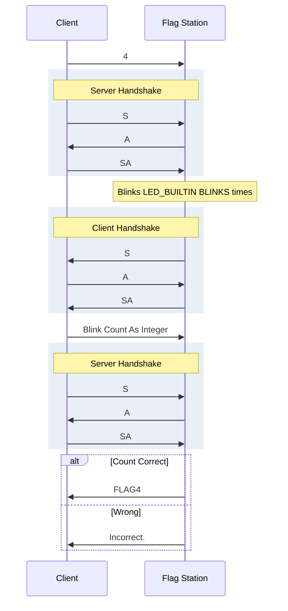

# Uno Flag Station

Firmware for Arduino Uno Flag Station Boards that serve `DSU{...}` flags over UART/Serial. The Station source code and the protocols are intended to be public.

Organizers flash this firmware onto flag stations. Participants connect a Client Uno with jumper wires, write firmware that speaks the flag protocols, and collect flags.

Station logic lives in [`src/main.cpp`](src/main.cpp). Host-side reference clients that speak the same bytes are in [`poc/`](poc/).

## Wiring

Connect the Client Uno to the flag station with jumper wires on the hardware UART pins (and ground):

| Flag Station | Client |
|--------------|-------------|
| TX (Pin 1)   | RX (Pin 0)  |
| RX (Pin 0)   | TX (Pin 1)  |
| GND          | GND         |
| Baud | 9600 |



Pins 0 and 1 are shared with the USB-serial chip. Use USB to flash and power boards. While collecting flags, talk over the jumpers from the participant board—avoid a second host driving the same UART at the same time.

## Architecture

| Item | Detail |
|------|--------|
| Board | Arduino Uno |
| UART | Pins 0 (RX), 1 (TX), GND |
| Baud | 9600 |
| LED | `LED_BUILTIN` |



## Build and Flash
Firmware can either be compiled using Arduine Web IDE, Arduino IDE, or Platform PIO.

Flags 1–4 are not hardcoded. Put them in a project-root `.env` (gitignored). Placeholders in [`include/flags.h`](include/flags.h) are used if a flag is missing. Alternatively, flags can be set in the flags.h at build time.
Flag 0 is the exception: it's set in [`src/main.cpp`](src/main.cpp) on purpose.

```env
BLINKS=<count>
FLAG1="DSU{...}"
FLAG2="DSU{...}"
FLAG3="DSU{...}"
FLAG4="DSU{...}"
```

At build time, [`scripts/env_flags.py`](scripts/env_flags.py) reads `.env` and injects the values as compiler defines:



```bash
pio run
pio run -t upload
pio device monitor -b 9600
```

## Obtaining Flags

Send a flag number (`0`–`4`) followed by a newline, then complete that flag’s protocol. On success the station prints a `DSU{...}` line.

| Flag | Concept |
|------|------|
| 0 | Introduction, Verify Functionality |
| 1 | Simple Request |
| 2 | Basic Authentication |
| 3 | Handshake |
| 4 | Handshake/Call Response |

### Handshake

A handshake confirms that both ends are present, listening, and speaking the same protocol before anything important is exchanged. Real networks use the same idea (for example TCP’s three-way handshake): each side sends a short signal and waits for a matching reply so neither starts mid-stream or talks past a board that is not ready.

Here the exchange is a tiny syn/ack-style dialog over UART—tokens `S`, `A`, and `SA`—implemented as `server_handshake()` and `client_handshake()` in [`src/main.cpp`](src/main.cpp).



When the station acts as server, the participant is the client (diagram above). When the station acts as client, roles reverse: station sends `S`, participant replies `A`, station sends `SA`.

### Flag 0

Send `0`, then `A`. The station replies `B`. Send `C` and it prints the flag. That string is the literal in `flag0()` in [`src/main.cpp`](src/main.cpp). 
Flag 0 is a hardcoded string meant to verify board functionality.  



### Flag 1

Request the flag; no further exchange.



### Flag 2

Send `2`, then the password line. The station expects `hello, world` and prints the flag when they match.



### Flag 3

Send `3`, then complete one server-side handshake (participant as client). Success returns the flag.



### Flag 4

Send `4`, complete a server handshake, watch `LED_BUILTIN` blink, complete a client handshake, send the blink count as an integer, complete another server handshake, then receive the flag or an error. Organizers set the blink count with `BLINKS` in `.env`.



## Proof of Concept

Proof of concept scripts can be found in [`poc/`](poc/). Uses the same serial protocol over USB (default `/dev/ttyACM0` at 9600). Useful for organizers and debugging. The participant path is jumpered Unos; the scripts show the exact byte sequences.

## Repository layout

| Path | Role |
|------|------|
| `src/main.cpp` | Flag Station Firmware |
| `include/flags.h` | `FLAG*` / `BLINKS` placeholders |
| `scripts/env_flags.py` | Injects `.env` into the build |
| `poc/` | Proof Of Concept Code |
| `platformio.ini` | Uno / PlatformIO config |
